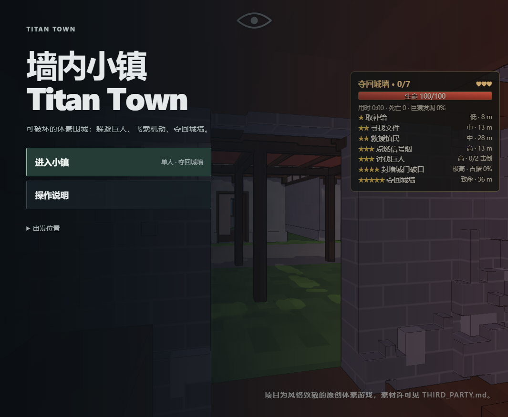
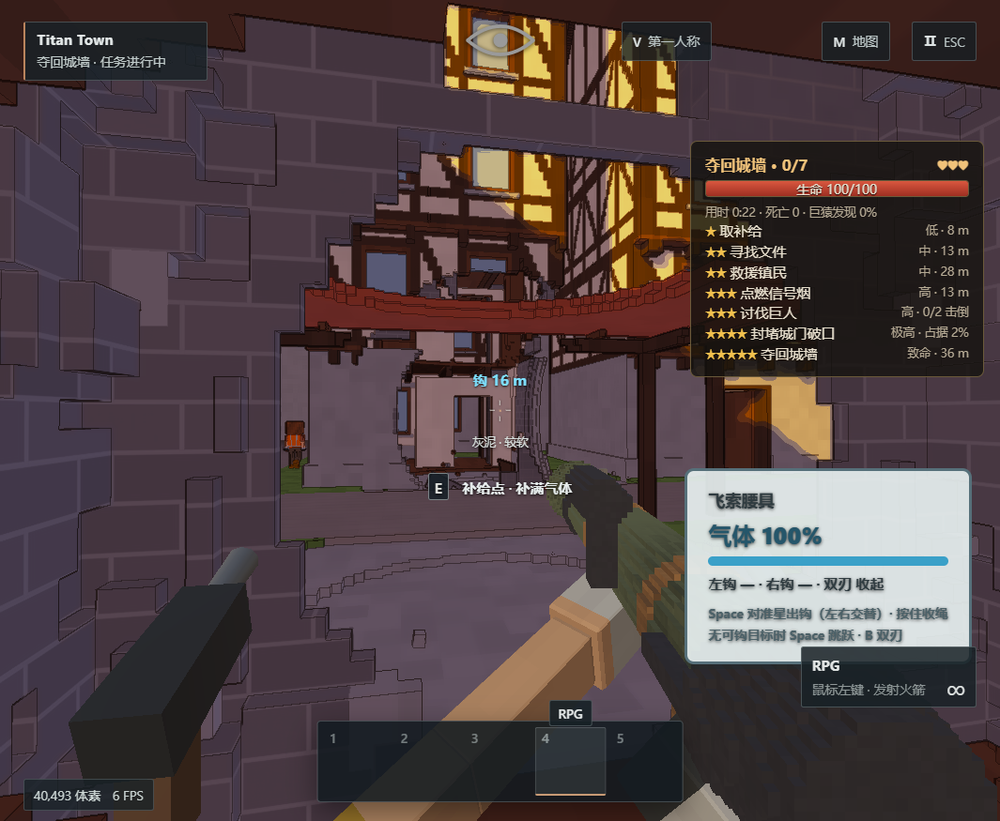

# Titan Town · Walled Town

**English** | [简体中文](README.zh-CN.md)

A destructible voxel siege game that runs in the browser: a medieval town enclosed by high walls where every house can be smashed open and brought down. Ground titans see, hear and tear houses apart, while a stone-throwing ape on the wall watches the open ground. Wearing grapple gear (hook swinging + gas jets), you have 3 lives to complete 7 missions and finally reclaim the wall.

> A style homage only. It contains no official characters, names, models or textures. The titans, grapple gear, map and text are original designs, and the project is not affiliated with any official work.




## Run

Requires Node.js 22+ and a modern browser with WebGL2 / WebAssembly SIMD (latest Chrome, Edge or Firefox). There are no third-party npm dependencies.

```bash
npm install     # no dependencies; only generates lockfile metadata
npm start       # http://127.0.0.1:4173/
```

To change the port: `PORT=4273 npm start` (PowerShell: `$env:PORT=4273; npm start`). Set `HOST=0.0.0.0` to allow LAN access.

## Language

The game UI is available in English and Simplified Chinese. It follows the browser language by default; use the language button in the main menu, or add `?lang=en` / `?lang=zh` to the URL (for example `http://127.0.0.1:4173/game.html?lang=en`). The in-game help panel lists all controls.

## Controls

| Key | Action |
| --- | --- |
| W A S D / mouse | Move / look |
| Shift / Space / Ctrl | Sprint / jump (fires a hook when the crosshair has a hook point) / crouch |
| Number keys / wheel, left mouse button, R | Switch tool, use it, detonate charges |
| E / B | Interact and resupply / draw the blades |
| M or Tab / Esc / V / H | Map / pause / switch view / help |
| F5 / F9 | Save / load |

## Tests

```bash
npm test        # voxel engine, rigid bodies, support collapse, and town / titan / mission logic; about 30 s
```

## Layout

```
game.html, style.css, main-menu.css   page and styles
server.js                              static server (allow-listed paths, no dependencies)
src/                                   voxel engine + rendering + titan AI + missions (native ES modules)
src/i18n.js                            small zh/en dictionary and language switch
assets/                                town scene, prefabs, voxel models, titan rig data
vendor/                                three.js (with a small patch), Rapier (WASM)
licenses/                              original licenses of third-party assets
tests/                                 node:test unit tests
DESIGN.md                              requirements and design notes
THIRD_PARTY.md                         third-party sources, licenses and checksums
```

## License

See [LICENSE](LICENSE) (code) and [THIRD_PARTY.md](THIRD_PARTY.md) (assets and dependencies). Chinese versions: [DESIGN.zh-CN.md](DESIGN.zh-CN.md), [THIRD_PARTY.zh-CN.md](THIRD_PARTY.zh-CN.md).
